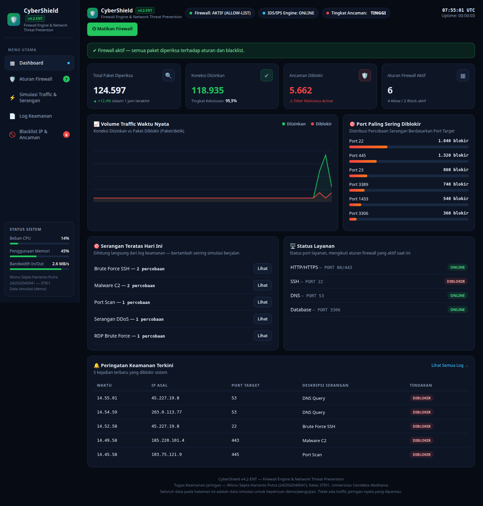

# CyberShield v4.2-ENT

**Firewall Engine & Network Threat Prevention** — aplikasi web untuk memantau aktivitas jaringan, mengelola aturan firewall, dan menampilkan simulasi ancaman keamanan jaringan.

🔗 **Live demo:** https://wisnunot.github.io/cybershield/



## Tentang

CyberShield dibuat sebagai tugas mata kuliah Keamanan Jaringan. Aplikasi ini menyimulasikan sebuah firewall engine lengkap dalam satu file HTML: dashboard monitoring live, manajemen aturan firewall, simulasi traffic dan serangan, log keamanan, serta blacklist IP.

Seluruh data pada aplikasi adalah **data simulasi** untuk keperluan demo dan pengujian — tidak ada traffic jaringan nyata yang dipantau atau diblokir.

## Fitur

### Dashboard Monitoring
- Total paket yang diperiksa, koneksi diizinkan, ancaman diblokir, dan aturan firewall aktif
- Grafik **Volume Traffic Waktu Nyata** (diizinkan vs diblokir, live)
- **Port Paling Sering Diblokir** (22, 445, 23, 3389, 1433, 3306)
- **Serangan Teratas Hari Ini** — dihitung langsung dari log keamanan
- **Status Layanan** — HTTP/HTTPS, SSH, DNS, Database (mengikuti aturan yang aktif)
- **Peringatan Keamanan Terkini** — 5 ancaman terakhir yang diblokir
- Jam UTC live, indikator tingkat ancaman, dan meter CPU / memori / bandwidth

### Manajemen Aturan Firewall
- Tambah aturan: nama, IP asal / CIDR (`192.168.1.0/24`, `0.0.0.0/0`), port (tunggal, daftar `3306,5432,1433`, atau `*`), protokol, aksi ALLOW / BLOCK
- Aturan dievaluasi **dari atas ke bawah** — aturan pertama yang cocok yang menang
- Toggle aktif / nonaktif dan hapus aturan
- 7 aturan awal (6 aktif): Allow LAN, Allow Web 80, Allow HTTPS 443, Block SSH 22, Block Telnet 23 (nonaktif), Allow DNS 53, Block SMB & RDP 445,3389

### Simulasi Traffic & Serangan
- Generator traffic otomatis dengan kecepatan Normal / Cepat / Sangat Cepat (bisa dijeda)
- 6 skenario serangan: **Port Scan**, **Brute Force SSH** (IP otomatis masuk blacklist), **DDoS / SYN Flood**, **SQL Injection**, **Malware C2**, **Serangan RDP/SMB**
- **Uji Koneksi Manual**: isi IP + port + protokol, firewall langsung memberi keputusan
- Tombol **Matikan Firewall**: saat nonaktif semua koneksi diizinkan dan muncul banner peringatan

### Log Keamanan
- Mencatat waktu, IP sumber, port tujuan, jenis aktivitas, tindakan, dan alasan
- Filter Semua / Diizinkan / Diblokir / **Ancaman Kritis**, pencarian, tombol **Detail** per baris
- **Export CSV** dan Hapus Log

### Blacklist IP
- Kartu ringkasan: total IP, blokir otomatis, blokir manual, total paket diblokir
- Tambah IP + alasan, lepas blokir, hitungan blokir per IP
- IP blacklist otomatis diblokir di semua port

## Cara kerja evaluasi koneksi

```
1. Firewall nonaktif            → DIIZINKAN (dengan peringatan)
2. IP ada di blacklist         → DIBLOKIR
3. Aturan aktif pertama cocok   → ALLOW → DIIZINKAN / BLOCK → DIBLOKIR
   (cocok = IP/CIDR + port + protokol)
4. Tidak ada aturan yang cocok → DIIZINKAN
```

## Cara menjalankan

Buka file `index.html` di browser — tidak perlu install apa pun. Data tersimpan di `localStorage` browser; tombol **Reset Data Demo** di halaman Aturan Firewall mengembalikan data awal.

Versi server (PHP + MySQL, `backend/`) tersedia di paket tugas lengkap, bukan di repository ini. GitHub Pages hanya menyajikan file statis, jadi yang live di sini adalah versi demo.

## Pengujian

Pengujian otomatis dengan Node.js + jsdom terhadap file `index.html` final: **40 pemeriksaan, semuanya lulus** — evaluasi koneksi per aturan & blacklist & CIDR, toggle aturan, firewall on/off, pencatatan statistik & log, skenario Port Scan, Brute Force, dan RDP/SMB 10/10 diblokir. Detail lengkap ada di dokumentasi pada paket tugas.

## Teknologi

HTML · CSS · JavaScript (tanpa framework, tanpa dependensi)

## Penulis

**Wisnu Septa Harianto Putra** — 242502040041, Kelas 3TI01
Program Studi Teknik Informatika, Fakultas Teknik, Universitas Cendekia Abditama
Mata Kuliah Keamanan Jaringan
